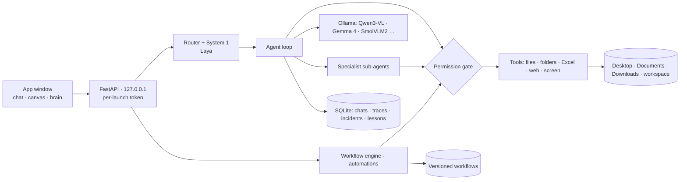

# NestCrew 🪺

**A local-first AI agent platform for your own PC.** Small open models do the work offline;
agents automate files, folders and spreadsheets like an RPA bot, ask before every risky step,
and every finished task can be saved as a visual, versioned workflow.


 


---

## What it does

| | |
|---|---|
| 💬 **Chat, Agent, Crew, Video** | Chat with a local vision model; give an **agent** a task and watch each step; run multi-agent **crews**; analyse **videos** frame by frame into a CSV + chart. |
| 🗂 **RPA tools** | Copy / move / rename files, create folders, find files, read / write / append **Excel & CSV** in Desktop, Documents, Downloads… Moves are undoable, nothing is overwritten, there is no delete tool. |
| 🧑‍💼 **Specialist sub-agents** | The main agent can **delegate** to a file clerk, Excel analyst, researcher or writer — each with its own small tool set and the same approval rules. |
| ✋ **Asks before acting** | Approval cards show exactly what will change (which files, which rows). Allow once / for this task / deny. Stop interrupts even a model mid-answer. |
| ◇ **Canvas** | n8n-style node editor: triggers (manual, watch folder, daily, every N min), vision, Decide, If, model, tool, agent, crew, note steps. Live run highlighting. |
| ⚙ **Save as RPA bot** | Turn any finished task into a bot that replays the exact tool steps — no AI in the loop — or into an AI flow that repeats the goal flexibly. |
| 🕘 **Versions & compare** | Every save is kept. Compare any past version with now (added / changed / removed steps highlighted on the canvas) and restore it. |
| ⚡ **System 1** | Instant typed decisions (task routing, hints, branching) from **Laya**, an open-source "System One" model, with MiniLM / keyword fallback. |
| ◎ **Brain & learning loop** | Every run is a trace. 👍 runs guide similar tasks and export as a fine-tuning dataset; 👎 opens an incident. |
| 🧩 **Right model per job** | One "brain" model plans; tiny "eyes" models (SmolVLM2 256M/500M, LFM2-VL, Granite Vision…) read screens, videos and documents. Paid cloud APIs are optional. |

## Architecture



More diagrams (request sequence, safety layers, model routing, learning loop, code map): **[docs/ARCHITECTURE.md](docs/ARCHITECTURE.md)**.

## Quick start (Windows)

1. Download or clone this repo into `Documents\NestCrew`.
2. Double-click **`Install NestCrew.bat`** — installs Python packages, Ollama, a model sized to your RAM,
   the tiny vision models and Laya, then adds a **NestCrew** shortcut. (Internet needed once.)
3. Double-click **NestCrew** on the Desktop. It starts Ollama and Laya by itself and opens the app.

Then try, in Chat:

> Move all files from BIRAC to BIRAC2 on my Desktop

System 1 recognises it as a file task and runs it as an agent; you approve the move in the chat;
press **⚙ Save as RPA bot** to repeat it later in one click — or give the bot a trigger to run on its own.

macOS / Linux: `bash scripts/setup.sh`, then `nestcrew app`. Full manual: **[GUIDE.md](GUIDE.md)** (also in the app).

## Command line

```bash
nestcrew doctor                      # check Ollama, models, internet
nestcrew app                         # open the app window
nestcrew agent "copy the pdfs from Downloads to Documents/Invoices"
nestcrew crew research_writer --input topic="solar panels"
nestcrew video clip.mp4 "How many people are visible?"
nestcrew models use screen smolvlm2-256m
nestcrew auto watch                  # run automations from a terminal
```

## Safety model

- Listens on `127.0.0.1` only; API calls need a fresh secret token per launch.
- Tools are `allow` / `ask` / `deny`; anything that changes files asks you, with a preview.
- File tools only reach Desktop, Documents, Downloads, Pictures, Videos, Music and the workspace;
  `.ssh`, `AppData`, system folders and the app's own folder are refused.
- No delete tool; no overwrites; moves/renames undoable; Excel and text files backed up before edits.
- Dangerous shell commands are blocked even if approved; tool output is treated as data, not instructions.
- Unattended automations can only use tools pre-approved for that workflow.
- Every action and decision is written to `data/audit.jsonl`.

## Tech

Python 3.10+ · FastAPI + Server-Sent Events · SQLite · Ollama · Laya (`/v1/systemone`) ·
openpyxl · OpenCV · vanilla HTML/JS (no build step) · pytest (100+ offline tests with scripted models) ·
GitHub Actions on Windows + Linux.

## Tests

```bash
pip install -e ".[dev,media]"
pytest -q        # fully offline: models are replaced by scripted stand-ins
```

## Project layout

```
nestcrew/        server, agent, tools, rpa, safety, workflows, system1, models, traces …
nestcrew/static/ the whole UI (one HTML file)
workflows/       starter Canvas templates
crews/           multi-agent recipes (YAML)
docs/            architecture
tests/           unit + API tests
models.yaml      model catalog and per-job assignment
config.yaml      permissions, folders, safety, System 1 engine
```

## Roadmap

- Record mouse/keyboard steps in desktop apps as bot steps
- Local RAG over your documents
- Voice in/out (whisper.cpp + Piper)
- Packaged installer (single .exe)

## Author

Built by **Bakulesh Rane** ([@Bakulesh1Codes108](https://github.com/Bakulesh1Codes108)). MIT licensed.
