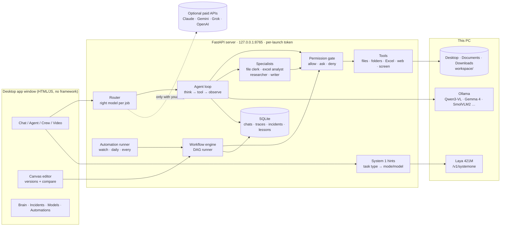
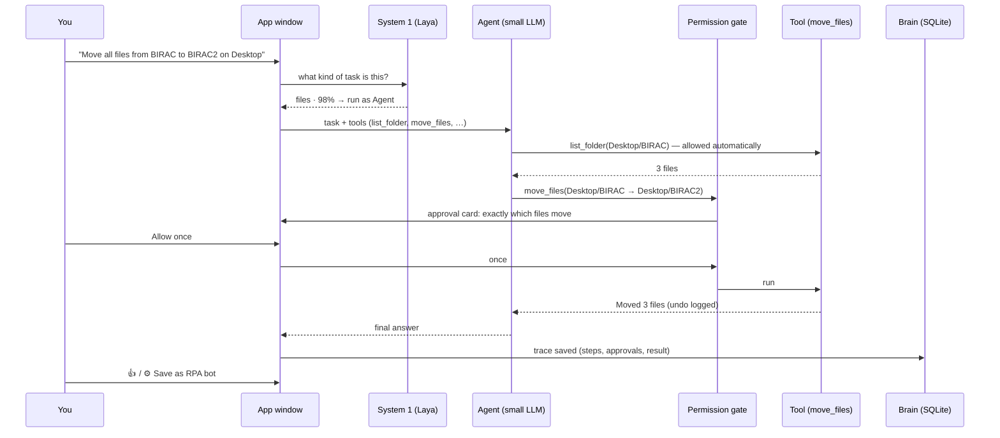
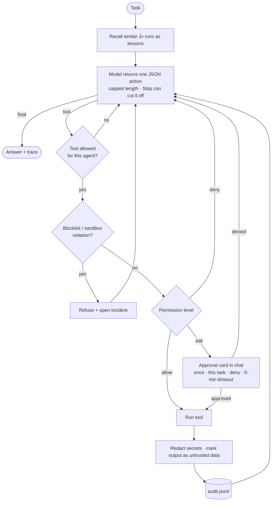
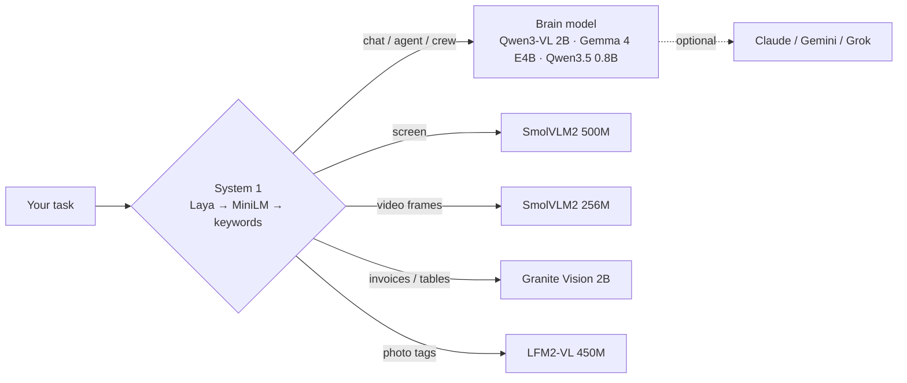
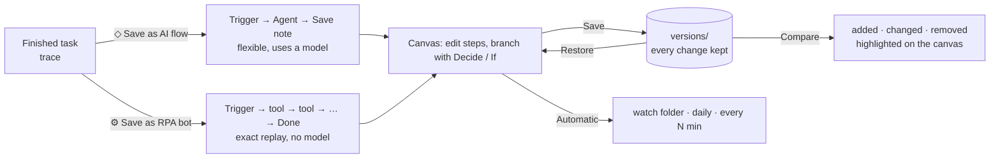
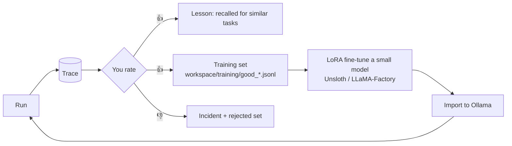

# NestCrew architecture

NestCrew is a local-first agent platform: a FastAPI server on `127.0.0.1` drives small
open models through Ollama, gates every risky action behind a human approval, records
every run, and lets you turn runs into visual, versioned workflows (AI flows or RPA bots).

## 1. System overview

## 2. One agent task, end to end

## 3. The agent loop and safety layers

| Layer | What it guarantees |
|---|---|
| Bind + token | Server listens on 127.0.0.1 only; every API call needs a fresh per-launch token (blocks other websites / DNS rebinding) |
| Permission gate | Every tool is `allow`, `ask` or `deny`; unattended runs can only use tools pre-approved for that workflow |
| Sandbox | File tools resolve paths inside Desktop/Documents/Downloads/… + workspace; `.ssh`, `AppData`, system folders, NestCrew's own folder are refused |
| No destructive tools | There is no delete tool; copies/moves never overwrite (`name (2).ext`); moves and renames are undoable; Excel/text files are backed up before changes |
| Command blocklist | `rm -rf`, `format`, `reg delete`, `shutdown`, piping downloads into shells … are refused even if approved |
| Prompt-injection guard | Tool output (web pages, files) is wrapped and labelled as data, never instructions |
| Audit | Every action and decision is appended to `data/audit.jsonl`; incidents collect failures and blocks |

## 4. Models: one brain, several eyes, a System 1

Each job (chat, agent, screen, video, documents, image) has its own model in `models.yaml`, switchable
in the Models page; a job falls back to the default model until its own is downloaded.

## 5. From a one-off task to a reusable, versioned flow

Workflow steps: Trigger, Look at screen, Look at image, Analyse video, Decide (System 1), If text contains,
Ask a model, Use one tool, Agent, Crew, Save to note, Final answer. Workflows are DAGs (loops are rejected),
text flows along arrows as `{input}`, and Decide/If steps choose which arrows fire.

## 6. Learning loop

## 7. Code map

| Module | Responsibility |
|---|---|
| `server.py` | FastAPI app, SSE streaming, approval round-trips, Stop, token guard, starts Ollama/Laya |
| `agent.py` | JSON tool-calling loop, lessons, cancellation, sub-agent context |
| `rpa.py` | Files/folders/Excel tools, sandboxed paths, previews, undo, specialist delegation |
| `tools.py` | Tool registry, workspace tools, web tools, screen tool, command tool |
| `safety.py` | Permission gate, blocklist, redaction, untrusted wrapping, audit log |
| `providers.py` | Ollama (streaming, capped, interruptible) + Claude/Gemini/OpenAI-compatible clients |
| `router.py`, `models.py` | Per-job model routing, catalog, downloads, fit-for-this-PC hints |
| `system1.py`, `hints.py` | Typed decisions via Laya/Kev/OpenJev/Cribl (`/v1/systemone`) or MiniLM; task routing |
| `workflows.py` | DAG engine, templates, capture (AI flow / RPA bot), versions, diff, restore |
| `automations.py` | Folder-watch and schedule runner for recipes and workflows |
| `traces.py`, `memory.py` | Run traces, incidents, training export, chats, lessons |
| `media.py` | Screenshots, video frame sampling, CSV/SVG charts |
| `static/index.html` | The whole UI: chat, progress panel, canvas editor, brain, models, guide |
